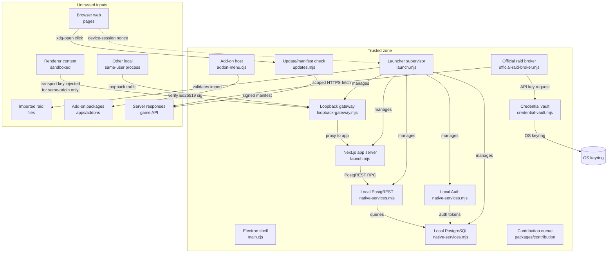

# Desktop Threat Model

> **Status:** Preview (Linux)
> **Scope:** Local-first desktop profile — see
> [ARCHITECTURE-DECISION](../apps/desktop/docs/ARCHITECTURE-DECISION.md).

## 1. Scope and Trust Boundaries

The desktop preview runs as a single-user, local-first application. All
application services execute on the same physical machine and communicate
over the loopback interface. This model treats the Electron renderer,
imported files, add-on packages, the official game API, the user's web
browser, and other same-user processes as untrusted relative to the launcher
process and local services.

macOS and Windows platform adapters are explicitly out of scope for this
model — the credential vault implementation throws on non-Linux platforms
until a tested adapter exists (apps/desktop/launcher/credential-vault.mjs).

### Trusted components

| Component          | Implementation                                                               | Role                                                                                                                                   |
| ------------------ | ---------------------------------------------------------------------------- | -------------------------------------------------------------------------------------------------------------------------------------- |
| Electron shell     | apps/desktop/launcher/main.cjs, apps/desktop/launcher/workspace.mjs          | Sandboxed renderer without Node integration; adds the transport header to requests to the gateway; serves pages with a restrictive CSP |
| Runtime supervisor | apps/desktop/launcher/launch.mjs                                             | Orchestrates native services, gateway, app server, and Electron; generates per-launch secrets                                          |
| Native services    | apps/desktop/proof/native-services.mjs, apps/desktop/proof/service-owner.mjs | Spawns PostgreSQL, Auth, PostgREST on loopback only                                                                                    |
| Loopback gateway   | apps/desktop/proof/loopback-gateway.mjs                                      | Binds to loopback; requires per-launch transport key; validates Origin and Host                                                        |
| Local database     | apps/desktop/proof/native-services.mjs                                       | PostgreSQL started with -h 127.0.0.1                                                                                                   |
| Local Auth         | apps/desktop/proof/native-services.mjs                                       | Supabase Auth stack on loopback                                                                                                        |
| Local PostgREST    | apps/desktop/proof/native-services.mjs                                       | PostgREST on loopback                                                                                                                  |
| App server         | apps/desktop/launcher/launch.mjs                                             | Next.js standalone server on loopback                                                                                                  |
| Credential vault   | apps/desktop/launcher/credential-vault.mjs                                   | OS keyring-backed storage; no renderer IPC surface                                                                                     |
| Official broker    | apps/desktop/launcher/official-raid-broker.mjs                               | Trusted gateway to the official game API                                                                                               |
| Add-on host        | apps/desktop/launcher/addon-menu.cjs, packages/addon-host/src/host.ts        | Loads add-on packages through the host contract; fixed IPC only                                                                        |
| Update check       | apps/desktop/launcher/updates.mjs                                            | Verifies manifest signatures and package hashes                                                                                        |
| Contribution queue | packages/contribution/                                                       | Opt-in offline queue; sync controls unmounted in desktop profile                                                                       |

### Untrusted inputs

| Input                 | Boundary path                                                                                                                                            |
| --------------------- | -------------------------------------------------------------------------------------------------------------------------------------------------------- |
| Renderer content      | Electron renderer (sandbox, contextIsolation, nodeIntegration=false)                                                                                     |
| Imported raid files   | JSON raid files (format ta-raid-file-v1) parsed by apps/desktop/launcher/raid-file-validation.mjs and imported via apps/desktop/launcher/raid-import.mjs |
| Add-on packages       | Packages loaded through packages/addon-host                                                                                                              |
| Server responses      | Responses from the official game API                                                                                                                     |
| Other local processes | Any same-user process on the loopback interface                                                                                                          |
| Browser web pages     | Pages opened in the user's system browser via apps/desktop/launcher/system-browser.cjs                                                                   |

### Trust boundary summary

The renderer cannot read secrets, cannot bypass the loopback gateway, and
cannot access the credential vault. The loopback gateway requires a per-launch
random transport key (64 hex characters generated fresh on each start in
apps/desktop/launcher/launch.mjs) that is never exposed to the renderer.
The credential vault is a trusted main-process primitive with no renderer IPC
or backend endpoint; it requires explicit user consent before touching OS
keyring storage.

## 2. Data-Flow Diagram

## 3. Permitted Network Destinations

| Destination             | Protocol                                                                                 | Purpose                                                                                                                                                                                                                                                                                                        | Evidence                                                                                                                                                |
| ----------------------- | ---------------------------------------------------------------------------------------- | -------------------------------------------------------------------------------------------------------------------------------------------------------------------------------------------------------------------------------------------------------------------------------------------------------------- | ------------------------------------------------------------------------------------------------------------------------------------------------------- |
| Loopback (localhost)    | TCP wire protocol (PostgreSQL) and HTTP (Auth, PostgREST, Next.js app, loopback gateway) | All local services bind to 127.0.0.1 only; PostgreSQL speaks its own wire protocol, the others HTTP                                                                                                                                                                                                            | apps/desktop/proof/native-services.mjs, apps/desktop/proof/service-owner.mjs, apps/desktop/proof/loopback-gateway.mjs, apps/desktop/launcher/launch.mjs |
| Official game API       | HTTPS                                                                                    | Player, Guild and Guild Raid endpoints with an API key header. Two modules make these calls: apps/desktop/launcher/official-access.mjs (mounted by the onboarding menu in the normal flow, 20 s timeout) and apps/desktop/launcher/official-raid-broker.mjs (redirects refused, cookies omitted, 15 s timeout) | apps/desktop/launcher/official-access.mjs, apps/desktop/launcher/official-raid-broker.mjs                                                               |
| Configured manifest URL | HTTPS                                                                                    | Update manifest fetch; origin validated; Ed25519 signature verified; default unset for the preview                                                                                                                                                                                                             | apps/desktop/launcher/updates.mjs                                                                                                                       |
| System browser          | xdg-open                                                                                 | External http(s) links open after a user confirmation dialog. Only a URL whose origin equals the gateway origin is refused; other loopback origins are not filtered                                                                                                                                            | apps/desktop/launcher/external-links.cjs, apps/desktop/launcher/system-browser.cjs                                                                      |

> The unshare --net offline journey (apps/desktop/proof/offline-journey.mjs)
> runs the application where non-loopback traffic cannot succeed. It shows the
> journey works offline; it does not trace or assert that no outbound
> connection is attempted.

## 4. Threats and Mitigations

| Threat                      | Mitigation                                                                                                                                                                                                                                                                                                                                                                                                                                                                                                                                                                                              | Evidence                                                                                                                                                                                                                          |
| --------------------------- | ------------------------------------------------------------------------------------------------------------------------------------------------------------------------------------------------------------------------------------------------------------------------------------------------------------------------------------------------------------------------------------------------------------------------------------------------------------------------------------------------------------------------------------------------------------------------------------------------------- | --------------------------------------------------------------------------------------------------------------------------------------------------------------------------------------------------------------------------------- |
| Browser-to-loopback attacks | The loopback gateway requires a per-launch 64-hex transport key that is never sent to the renderer; requests are validated by Origin and Host headers; the gateway binds to loopback only; the launcher-served /desktop/* pages carry a CSP of default-src 'none', connect-src 'self' and frame-ancestors 'none' (apps/desktop/launcher/workspace.mjs), while the core application pages are served through proxy.ts with its own production CSP (default-src 'self' plus additional image, worker and connect origins), so the Electron request filter is the common restriction                       | apps/desktop/proof/loopback-gateway.mjs, apps/desktop/proof/loopback-gateway.test.mjs, apps/desktop/launcher/main.cjs                                                                                                             |
| Same-user local processes   | The transport key is random per launch, but launch.mjs writes it (with other launch values) to window-config.json in the state directory with mode 0600 for the Electron process and does not delete it, so a process running as the same user can read it while the gateway is up (see Open decisions); all services bind to loopback only; game API credentials live in the OS keyring behind an explicit consent prompt and never enter process arguments, environment variables, or renderer IPC; credential directory uses mode 0o700 and files use 0o600; O_NOFOLLOW prevents symlink replacement | apps/desktop/launcher/credential-vault.mjs, apps/desktop/proof/credential-vault.test.mjs, apps/desktop/launcher/native-secret.mjs, apps/desktop/proof/safe-files.mjs                                                              |
| Update/module supply chain  | Update manifests are signed Ed25519; downloaded packages are verified against a SHA-256 digest and an Ed25519 signature; the download URL must share the manifest origin, must start with /packages/, and must end with .pkg.tar.zst or .deb; add-on packages are checked by the add-on host contract (packages/addon-host/src/host.ts and contract.ts); see docs/addons for the package rules                                                                                                                                                                                                          | apps/desktop/launcher/updates.mjs, apps/desktop/proof/updates.test.mjs, apps/desktop/launcher/addon-menu.cjs, apps/desktop/proof/addon-menu.test.mjs, packages/addon-host/src/host.ts                                             |
| Secret logging              | Native OS secret input goes directly to trusted main-process memory and never enters process arguments, environment variables, renderer IPC, or diagnostics; the credential vault rejects any result whose serialization includes the raw secret; the official raid broker rejects any API response whose body or metadata echoes the API key in any encoding (hex, base64, upper/lower)                                                                                                                                                                                                                | apps/desktop/launcher/native-secret.mjs, apps/desktop/launcher/credential-vault.mjs (anti-leak check at line 174), apps/desktop/launcher/official-raid-broker.mjs (anti-leak check at lines 113-129)                              |
| Cross-guild publication     | Row-level security is enabled across the schema and forced on the tables that carry guild data in apps/desktop/local-schema/authority.sql (not every table, for example some reference and grant tables are only enabled); the import role (desktop_importer) is limited by row-level policies such as desktop_import_guild to the workspace's own guild; the official raid broker verifies the API-returned guild ID and guild tag against the user's bound guild before caching, and revokes on mismatch; the team roster RPC fails closed on foreign-guild selectors                                 | apps/desktop/local-schema/authority.sql (desktop_importer role and its desktop_import_* policies), apps/desktop/launcher/official-raid-broker.mjs (guild verification in #binding), apps/desktop/proof/roster-validation.test.mjs |

## 5. Local Game-Client Connection Boundaries

The desktop preview does **not** connect to a local game client process.
Guild raid data can arrive by two routes, and the application does not make
them exclusive: both can feed the same import endpoint and coexist.

1. **Official API.** apps/desktop/launcher/official-access.mjs (mounted by
   the onboarding menu in the normal flow) and
   apps/desktop/launcher/official-raid-broker.mjs fetch the player, guild and
   guild raid endpoints. The broker refuses redirects, omits cookies and
   checks that the returned guild matches the bound guild before accepting a
   response. Roster snapshots obtained this way are written through
   apps/desktop/launcher/roster-import.mjs, which requires a main-process-only
   capability header and is governed by the desktop_roster_* role and policies
   in apps/desktop/local-schema/authority.sql.

2. **Local raid file.** A user-selected JSON raid file (format
   ta-raid-file-v1) is parsed by
   apps/desktop/launcher/raid-file-validation.mjs and imported via
   apps/desktop/launcher/raid-import.mjs. Imported rows are restricted to the
   workspace guild by the desktop_import_* policies in
   apps/desktop/local-schema/authority.sql. There is no user-facing roster file
   importer in this profile.

Game API credentials are stored in the OS keyring via the credential vault
(apps/desktop/launcher/credential-vault.mjs) and are **never** sent to the
analytics or contribution service. The contribution queue
(packages/contribution/) does not mount in the desktop profile, and its
upstream fetcher only contacts the official game API over HTTPS.

## 6. Open Decisions

The following items require owner sign-off and are **not** resolved by this
document:

- **Transport key at rest.** window-config.json holds the transport key for
  the lifetime of the launch. Whether to deliver it to Electron without a
  file (for example over an inherited descriptor) or accept the same-user
  exposure needs owner sign-off.
- **External loopback links.** The external-link filter refuses only the
  gateway origin. Whether other loopback origins should also be refused
  needs owner sign-off.
- **macOS/Windows security parity.** The credential vault and service
  bindings are verified on Linux only (credential-vault.mjs throws on
  other platforms). macOS and Windows adapters need tested storage and
  network-isolation equivalents before claiming parity.
- **Production network-namespace isolation.** The unshare --net offline
  journey (apps/desktop/proof/offline-journey.mjs) verifies in a lab that
  the app makes no stray outbound connections, but this isolation is not
  applied in the current production launcher.
- **Update manifest URL configuration.** The default manifest URL is unset
  (updates.mjs); a production value and key-rotation procedure need to be
  defined.
- **Add-on package signing scope.** Only first-party data packages are
  supported. A policy for community-contributed or user-authored add-ons is
  not yet defined.
- **Contribution queue desktop integration.** Whether and how the opt-in
  contribution queue integrates into the desktop profile is undecided.
- **Cluster-wide visibility scope.** get_guild_team_roster in
  apps/desktop/local-schema/authority.sql resolves membership through the
  caller's guild codes and cluster guild codes. Whether that cluster-wide
  reach is intended for the desktop profile needs owner sign-off.
